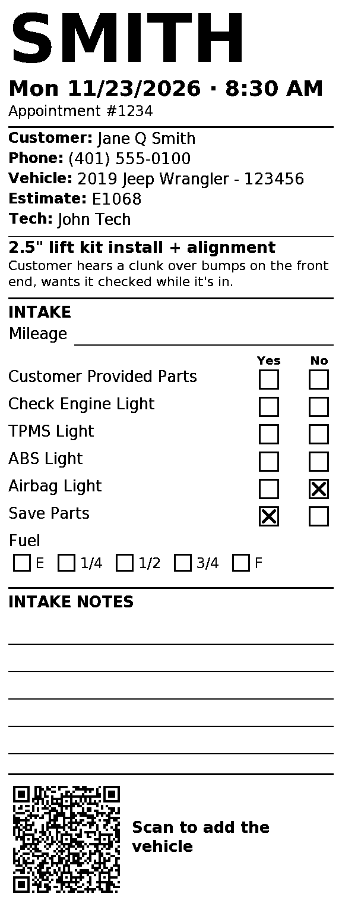

# Redmine QBO Tickets

Prints a **key ticket** for an appointment ([redmine_qbo_calendar](https://github.com/rickbarrette/redmine_qbo_calendar)) on a Star receipt printer. The ticket goes in the key folder when the customer drops off, before the vehicle's intake. It replaces the sticky notes, and it names the keys while they wait.



* **Who and when:** the customer's last name in big letters and the appointment's day and time, readable above the folder's edge.
* **The appointment:** customer, phone, estimate (E1234), work order (W1234, once there is one), technician and the job. Other plugins add lines, e.g. [redmine_qbo_vehicles](https://github.com/rickbarrette/redmine_qbo_vehicles) adds the vehicle.
* **Notes:** the appointment's description under **NOTES**, formatted as Redmine formats it (Markdown or Textile): bold, italics, lists, task boxes, quotes, alerts like `> [!IMPORTANT]`, headings and code. Issue references like `##1234` print as W1234.
* **Intake:** the work order custom fields you choose (e.g. Mileage, Check Engine Light, TPMS Light, ABS Light, Airbag Light, Save Parts), drawn by their format:
  * yes/no fields: **Yes** and **No** boxes, so a box left empty is never mistaken for "no";
  * lists of up to 6 choices: a box for each;
  * anything else: a line to write on.

  When the appointment's work order already has a value, it's printed (ticked) instead.
* **Intake notes:** lines for handwritten notes (5 by default).
* **QR code:** opens the appointment; with redmine_qbo_vehicles it opens the vehicle, or, when the appointment has none yet, adds one for the customer that becomes the appointment's vehicle.
* **When it was printed**, small at the bottom.

**Print key ticket** is in the appointment page's top-right actions. The dialog shows the ticket exactly as it will print (black and white, 72mm wide), then follows it until it's printed, like the Print label dialog.

<br clear="right">

## How it prints

The browser draws the ticket and sends the picture to a **receipt printer** set up in [redmine_qbo_labels](https://github.com/rickbarrette/redmine_qbo_labels) (**Administration » Label printers**, type *Receipt printer*). Its print agent ([redmine_qbo_label_agent](https://github.com/rickbarrette/redmine_qbo_label_agent), with `PRINTER_TYPE: star`) prints it and cuts it off. Redmine never talks to the printer, so tickets print from a phone or from home.

Made for the Star TSP143IIILAN (TSP100III series, 80mm paper).

## Requirements

* Redmine 7
* redmine_qbo 2026.11.0, redmine_qbo_calendar 2026.11.12 and redmine_qbo_labels 2026.11.3 or later
* A Star TSP100III receipt printer on the network, and a computer on the same network that runs Docker, for the print agent

## Installation

```
cd /path/to/redmine/plugins
git clone https://github.com/rickbarrette/redmine_qbo_tickets.git
```

Restart Redmine, then:

1. **Administration » Label printers » New label printer**: type *Receipt printer*. Run the print agent with the Compose file shown (set `PRINTER` to the printer's address).
2. **Administration » Plugins » Redmine QBO Tickets plugin » Configure**: tick the work order custom fields to print, and how many lines for notes.
3. **Administration » Roles and permissions**: give the roles that check customers in **Print key tickets** (they also need **View customer appointments**).

## Hooks

Other plugins add to the ticket with these hooks (context: `appointment`, and `base_url`, Redmine's address for links):

Hook | Return
---|---
`:qbo_tickets_details` | An array of `[label, value]` lines, shown under the customer, e.g. `[['Vehicle', '2019 Jeep Wrangler']]`
`:qbo_tickets_qr` | `{ url:, caption: }` for the QR code (the first listener's). Without one, it opens the appointment

## License

MIT. The ticket's letters are DejaVu Sans (see `assets/fonts/LICENSE`); the QR codes are made with [qrcode-generator](https://github.com/kazuhikoarase/qrcode-generator) by Kazuhiko Arase (MIT).
